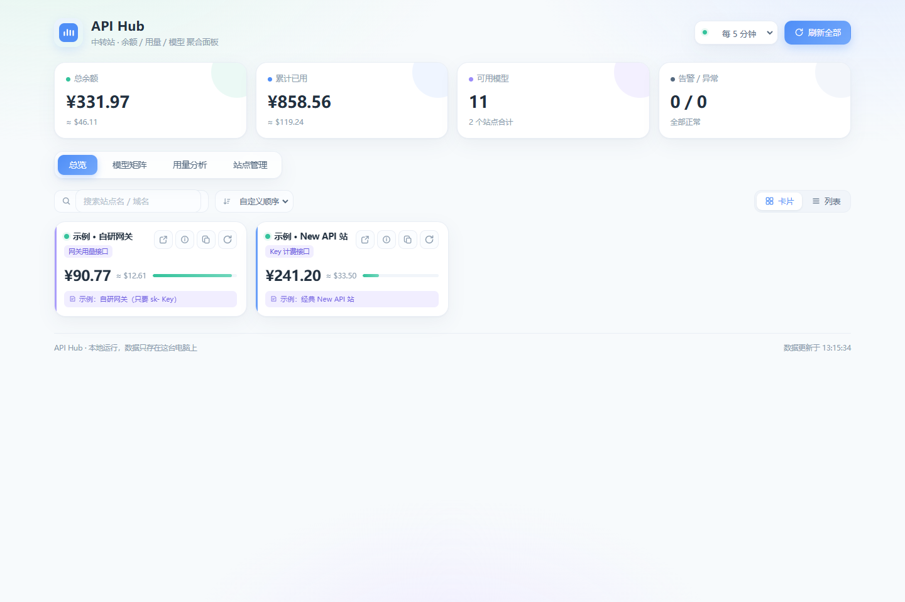
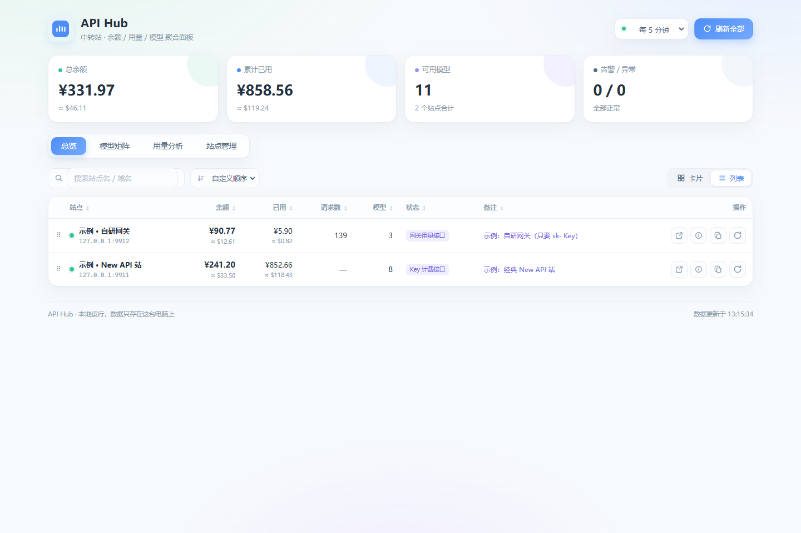
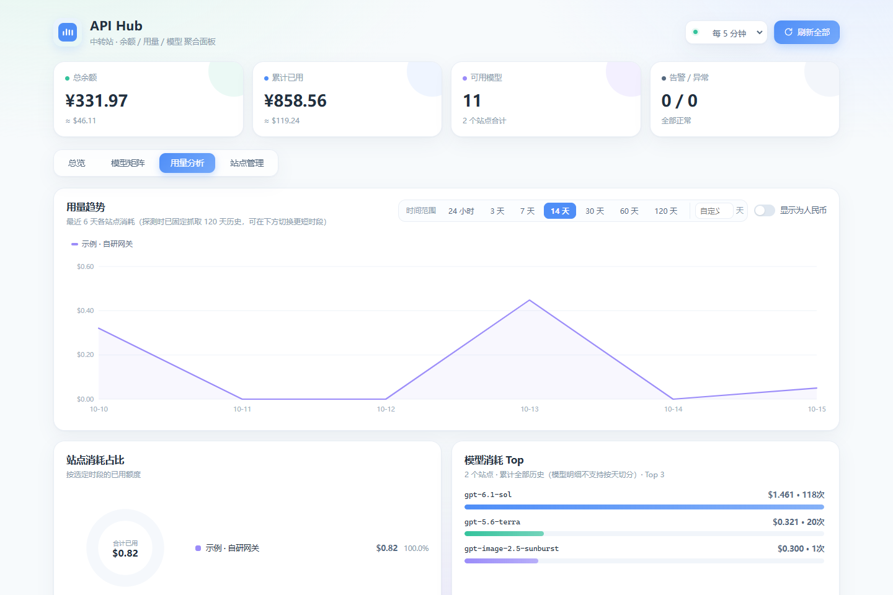
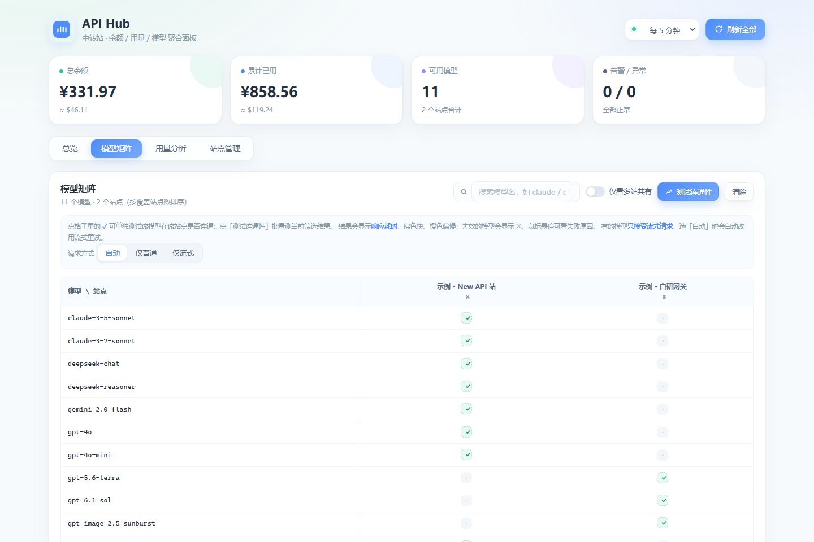
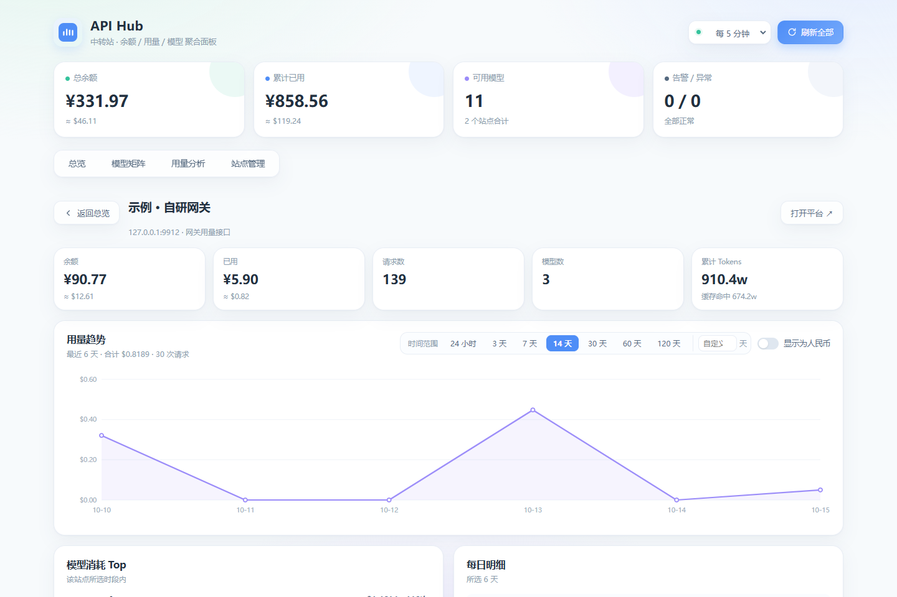

# API Hub · 中转站聚合面板

把散在各个 AI 中转站的**余额、用量、模型列表、调用日志**集中到一个页面。
本地运行、零第三方依赖、只监听 `127.0.0.1`，配置和密钥都只存在这台电脑上。

<p align="center">
  
</p>

> 开源协议：MIT。本仓库**不含任何用户配置或密钥**，所有站点信息需自行添加。
> 截图均为内置 mock 数据（`tests/mock_relay.py`）生成的演示界面。

| 总览 · 列表视图 | 用量分析 |
| --- | --- |
|  |  |
| **模型矩阵** | **单站详情** |
|  |  |

---

## 环境要求

- **Python 3.8+**（唯一依赖。只用标准库，**不需要 pip install 任何东西**）
- Windows / macOS / Linux 均可
- 现代浏览器（Chrome / Edge / Firefox）

---

## 快速开始
>点绿色的 Code 按钮--
>选 Download ZIP--
>解压后就能用

**Windows**：双击 **`start.bat`**

**Linux / macOS**：
```bash
chmod +x start.sh && ./start.sh
```

**或直接命令行**：
```bash
python server.py            # 默认 8765 端口
python server.py --port 8800
```

启动后浏览器打开 <http://127.0.0.1:8765/>，切到 **站点管理 → 添加站点**，
填 Base URL + 密钥，保存即自动探测。关闭：在命令行窗口按 `Ctrl+C`。

> 若提示找不到 Python，去 <https://www.python.org/downloads/> 装一个，
> 安装时记得勾选 **Add Python to PATH**。

---

## 站点怎么填

| 字段 | 说明 |
| --- | --- |
| **Base URL** | `https://your-relay.com` 或 `https://your-relay.com/v1`，带不带 `/v1` 都行 |
| **API Key** | `sk-` 开头，用来拉模型列表、以及站点的兼容计费接口 |
| **访问令牌 / 会话 Cookie** | **按需填写**，不一定需要。见下方「凭证怎么找」 |
| **用户 ID** | 配合上面凭证使用的数字 ID，个人设置页能看到 |
| **额度换算比** | 默认 `500000 quota = 1 USD`。若显示的余额量级明显不对，改这个值 |
| **跳过 HTTPS 证书校验** | 只在该站证书异常（自签名、过期、域名不匹配）导致连不上时才勾选 |

### 为什么有的站不用填两组凭证？

因为不同站的后端实现不一样，程序会自动探测、**需要什么就提示你填什么**（卡片右上角有模式标签）：

| 站点类型 | 例子 | 需要的凭证 |
| --- | --- | --- |
| 自研网关，`/v1/usage` 用 `sk-` Key 就能查余额 | 多数自定义网关 | **只要 API Key** |
| 原版 New API / One API，`session` Cookie 就够 | 多数常见中转站 | **只要会话 Cookie** |
| 新版 New API，浏览器里只有 `new_api_refresh`（没有 `session`） | 部分 New API 系站点 | **要 `new_api_refresh`**（程序自动换令牌，填一次长期可用） |
| 走系统访问令牌的站 | — | **访问令牌 + 用户 ID** |

所以「要不要填第二组凭证」取决于站点后端，而不是你的操作问题。探测完卡片会标注实际生效的模式，点 **ⓘ** 能看到每种凭证的尝试结果。

---

## 关于额度换算比

New API 系站点的数据库里，额度是用整数 `quota` 存的，不是美元。New API 的默认约定是：

```
500000 quota = 1 USD     （即 1 quota = 0.000002 USD）
```

所以程序默认按 `500000` 换算。两种例外：

- 站点 `/api/status` 返回了 `quota_per_unit` 字段 → **自动采用站点的真实值**，不用你管
- 站点自己改过换算比且没暴露该字段 → 余额量级会明显不对（比如差 100 倍），这时手动改这一项

自研网关（标「网关用量接口」的站）返回的本来就是美元金额，**这一项对它们无效**。

## 关于「跳过 HTTPS 证书校验」

正常访问 HTTPS 时，程序会校验证书是否由可信机构签发、域名是否匹配。校验失败就会直接报错连不上。

少数私人/小型中转站用的是**自签名证书**，或者证书过期、域名写得不一致——这时候校验必然失败，但站点其实是能正常用的。勾选这一项就跳过校验，把数据拉回来。

> ⚠️ 跳过校验意味着放弃对「中间人」的防护。只在确实连不上、且你信任该站时才勾。正常情况下保持不勾。

## 关于美元汇率

只影响**界面显示单位**，不影响任何数据准确性。设成 `7.2` 就把 $ 换算成 ¥ 展示；不需要就直接用美元看。用量分析页可在 USD / CNY 之间切换。

---

## 凭证怎么找

`sk-` 开头的 API Key **只能调模型**，查不了余额。要读余额和用量，需要下面**任一种**账户级凭证：

### ① 系统访问令牌（推荐）

登录站点 → 右上角头像 → **个人设置** → **安全设置** → 生成并复制「系统访问令牌」。

> 各站叫法不统一，请留意这些名字：**访问令牌 / 系统令牌 / 系统访问令牌 / AccessToken / 个人令牌 / 管理令牌**。
> 它和 Token 管理页里那些 `sk-` 开头的 Key **不是一回事**。

同时记下同一页面上显示的**数字用户 ID**（也有站点写在网址或账号信息里），填到「用户 ID」。

### ② 会话 Cookie（找不到①时用）

站点没开放访问令牌也没关系，借用浏览器的登录态：

1. 用浏览器登录该站点
2. 按 **F12** 打开开发者工具 → 切到 **Application**（应用）标签
3. 左侧 **Cookies** → 点开该站点的域名
4. 复制下面其中一条的 **Value**，粘到「会话 Cookie」输入框：
   - 大多数站：名为 **`session`** 的那条
   - 新版界面站（没有 session，只有 `new_api_refresh`）：复制 **`new_api_refresh`** 的完整 Value。
     程序每次刷新会自动用它换新令牌并把新令牌写回配置，**填一次长期可用**；
     注意这类令牌是一次性轮换的，复制后别再刷新/退出那个浏览器会话，否则刚复制的会作废
5. （直接粘 `session=xxx` 或 `new_api_refresh=xxx` 也可以）

⚠️ 注意别复制错：`new_api_has_session=1` 只是个"是否已登录"的**标记**，不是会话本体——真正的 `session` 值很长（通常是一长串字母数字）。填错了程序会提示。

Cookie 是有有效期的，过期后重新复制一次即可。

---

### 四种数据能力（程序自动探测，卡片上会标注）

| 模式 | 需要什么 | 能拿到什么 |
| --- | --- | --- |
| **完整数据** | 访问令牌 或 会话 Cookie（+ 用户 ID） | 余额、已用额度、请求数、调用日志、模型列表、令牌列表、用量趋势 |
| **Key 计费接口** | 只要 `sk-` Key | 余额、已用额度（走 OpenAI 兼容的 `dashboard/billing` 接口）、模型列表 |
| **网关用量接口** | 只要 `sk-` Key | 余额、累计用量、按天用量、按模型用量、Token 汇总（走自研网关的 `/v1/usage` 接口） |
| **仅模型列表** | 只要 `sk-` Key | 只有模型列表，拿不到余额 |

探测失败或数据不对时，点站点卡片右上角的 **ⓘ**，能看到每个接口的原始返回（含实际生效的是哪一种凭证），方便排查。

---

## 功能

- **总览** — 总余额 / 累计已用 / 可用模型数 / 告警数；**卡片 / 列表两种视图**（右上角切换，会记住选择），支持站点搜索。卡片**只留关键信息**：首行是名称，中间是余额（读不到时显示 —，悬停看原因），下方只留备注；接口标识（网关用量接口 / 完整数据 · 令牌 / 完整数据 · Cookie）显示在名称下方。**排序**：工具条可选按名称 / 余额 / 已用 / 请求数 / 模型数 / 备注 / 状态排序（升 / 降可切），或选「自定义顺序」直接**拖拽卡片 / 行**排列（顺序保存在本地）；列表视图中状态列在备注左侧
- **Cookie 自动续期** — 会话 Cookie 过期后程序自动调站点的刷新接口换新 Cookie 并回写配置，一次填写长期可用（前提：粘贴的 Cookie 里带 `new_api_refresh`，或站点支持刷新接口）；探测详情里可看到续期过程（`session_renew`）
- **模型矩阵** — 行是模型、列是站点，一眼看出哪个模型哪几个站有；支持**模型连通性测试**（逐格或批量，可选「自动 / 仅普通 / 仅流式」请求方式）
- **用量分析** — 消耗趋势折线（自绘 SVG）、站点消耗占比环形图、模型消耗 Top 榜；**时间范围**可选 24 小时 / 3 / 7 / 14 / 30 / 90 天或自定义（最多 120 天）；可切换美元 / 人民币
- **站点详情** — 余额统计、用量趋势（同样带时间范围切换）、模型消耗 Top、每日明细；**模型列表支持逐个点测或一键全部测试连通性**
- **添加站点 · 智能识别** — 表单顶部有识别框，把站点的 JSON 配置、.env、YAML、curl 命令或「域名 + sk-」纯文本粘进来（或直接 Ctrl+V），自动解析填入 Base URL / API Key / 访问令牌 / 会话 Cookie / 用户 ID / 名称
- **添加站点 · 先测一测** — 保存前点「测试连通」，不保存直接验证 URL + Key：报告可达性、Key 有效性、模型数量、余额和实际生效的接口方式
- **站点管理** — 增删改站点、全局设置（告警阈值 / 超时）、配置导入导出（命令行层面保留）
- **一键复制** — 卡片上的复制按钮直接拿到 `Base URL` + `API Key`，粘贴进 Cherry Studio / CC Switch 等客户端，复制成功有提示
- **自动刷新** — 右上角可选 1 / 5 / 15 / 30 分钟

### 关于换算与汇率

- **额度换算比**：程序自动优先采用站点 `/api/status` 里声明的 `quota_per_unit`（New API 默认 500000 quota = 1 USD），自研网关返回的本来就是美元——绝大多数情况**无需手动配置**。个别站点确需覆盖时，直接改 `config.json` 里对应站点的 `quota_per_usd`
- **美元汇率**：默认 7.2，仅用于界面人民币参考值。需要改也直接改 `config.json` 的 `usd_cny`

### 关于用户 ID

只有走「访问令牌 / 会话 Cookie」读余额的站才需要（New API 要求请求带 `New-Api-User` 头）。只要 sk- Key 就能出数据的站（卡片上标「网关用量接口」或「Key 计费接口」）不用填。

### 模型连通性测试

在**模型矩阵**页或**站点详情**页的模型区都能测。原理是向该站的 `/v1/chat/completions` 发一个 `max_tokens: 1` 的最小请求：

- ✓ 绿色 = 调通了（Key 有该模型权限且模型可用），显示响应耗时
- ✗ 红色 = 失败，鼠标悬停看具体原因（如无权限、模型下线、余额不足）
- **有的模型只接受流式请求**——「自动」模式下普通请求被拒时会自动改用 `stream=true` 重试；也可手动固定「仅普通 / 仅流式」

> 测试会**真实产生极少量 token 消耗**（通常远小于 0.0001 USD）。一次最多 200 项、8 并发，避免把站点打爆。

### 接口探测是什么？

点站点卡片右上角的 **ⓘ**，展开「接口探测」面板——它列出程序刚才为了拿数据**实际请求了哪些地址**、返回了什么（HTTP 状态码 + 原始响应片段，含凭证类型），例如：

```
GET  /api/user/self          → 200  {"success":true,"data":{"quota":...}}
GET  /api/status             → 200  {"quota_per_unit":500000,...}
GET  /v1/models              → 200  {"data":[...]}
```

用途是**排查问题**：余额显示为 0、提示凭证无效、拉不到模型时，看一眼就知道是哪一步失败了、站点实际返回了什么。

---

## 文件说明

```
api-hub/
├─ start.bat            Windows 一键启动（双击这个）
├─ start.sh             Linux / macOS 启动脚本
├─ server.py            后端：静态服务 + 站点探测 + 本地配置读写（单文件，纯标准库）
├─ config.example.json  配置结构示例（首次启动会自动复制为 config.json）
├─ config.json          你的站点配置（含密钥，自动生成，已被 .gitignore 忽略）
├─ data/snapshot.json   最近一次探测结果缓存（已被 .gitignore 忽略）
├─ web/                 前端页面（index.html / style.css / app.js）
├─ docs/screenshots/    README 演示截图
└─ tests/               开发自测（mock_relay.py 模拟站点 + selftest.py 断言 + smartparse.test.js 智能识别）
```

---

## 开发与自测

```bash
# 后端全量自测（104 项断言，含探测降级 / Cookie 续期 / 令牌轮换等）
python tests/selftest.py

# 智能识别解析器测试（Node）
node tests/smartparse.test.js

# 启动本地模拟站点（New API 站 9911 / 自研网关 9912），配合测试
python tests/mock_relay.py
```

CI 会在 Ubuntu / Windows / macOS × Python 3.9 / 3.11 / 3.13 的矩阵上自动跑这些测试（见 `.github/workflows/ci.yml`）。

欢迎 Issue 和 PR：修 bug、补新站点类型的探测、改进 UI 都可以。

---

## 免责声明

本工具仅做**只读聚合展示**，所有数据来自你自己的站点账号，不会上传到任何第三方。
请在遵守各中转站服务条款的前提下使用；流量消耗、账号安全由使用者自行负责。

## 常见问题

**余额显示成 0 或量级不对？**
站点设置里的「额度换算比」不对。New API 默认 500000，少数站会用别的值。
若站点 `/api/status` 暴露了 `quota_per_unit`，程序会自动采用，不用手动改。

**某个模型测试显示 ✗？**
先确认失败原因是「无权限」还是「模型不存在」——鼠标悬停格子看详情。Key 被限制了模型范围时，改用有权限的 Key。

**站点里找不到「系统访问令牌」？**
改用「会话 Cookie」方式：浏览器登录该站 → F12 → Application → Cookies → 复制 `session` 的值。
也可以顺手在站点后台翻一翻，很多站把它叫「系统令牌」「访问令牌」「AccessToken」「个人令牌」。
另外有些自研网关**根本不需要访问令牌**——只要填 `sk-` Key，程序会自动走它的 `/v1/usage` 接口拿到余额和用量（卡片标注「网关用量接口」）。

**提示"凭证无效"？**
先确认用户 ID 填对了（必须是数字，且和凭证属于同一账号）；Cookie 过期的话重新复制一次。
编辑站点时凭证默认以「闭眼」（掩码）显示，点输入框右侧的眼睛图标可查看明文；留空表示保持原值不变。

**某些站拉不到模型列表？**
站点可能关闭了 `/v1/models`，或该 Key 被限制了模型范围。点 ⓘ 看返回内容。

**端口被占用？**
`server.py --port 8800`，或改 `start.bat` 里的命令。
